<div align="center">

# DeadDrop

### Resilient Offline P2P Mesh Ledger and First-to-Sync Emergency Uplink Gateway

*Disaster coordination that keeps working when the network dies.*


</div>

---

## Contents

1. [Overview](#1-overview)
2. [Key features](#2-key-features)
3. [System architecture](#3-system-architecture)
4. [How an operation works](#4-how-an-operation-works)
5. [Peer-to-peer sync](#5-peer-to-peer-sync)
6. [Conflicts and scarce items](#6-conflicts-and-scarce-items)
7. [First-to-Sync uplink](#7-first-to-sync-uplink)
8. [Security model](#8-security-model)
9. [Partition and convergence](#9-partition-and-convergence)
10. [Multi-node roles](#10-multi-node-roles)
11. [Tech stack and project structure](#11-tech-stack-and-project-structure)
12. [Build, install and run](#12-build-install-and-run)
13. [Testing and evidence](#13-testing-and-evidence)
14. [Live demo walkthrough](#14-live-demo-walkthrough)
15. [Limitations and roadmap](#15-limitations-and-roadmap)

---

## 1. Overview

### The problem
During floods, earthquakes, conflicts and internet shutdowns, networks fail exactly when people need to coordinate. Rescuers fall back on paper and shouted updates, then try to reconcile everything later. Two teams promise the same boat. Supply counts disagree. A missing person is marked "found" on one phone and overwritten on another.

### The solution
DeadDrop is a coordination platform built for **zero-connectivity environments**.

| Principle | What it means in DeadDrop |
|---|---|
| **Offline first** | Every phone records and reads data locally. No server is required |
| **Actions, not state** | Every change is a small signed record called an *operation* (op). The screen is calculated from the set of ops |
| **Peer-to-peer sync** | Phones exchange only the ops the other is missing when they come near each other |
| **Safe merging** | Combining op sets gives the same result on every phone, in any order, and nothing is overwritten |
| **First-to-Sync uplink** | Whichever phone regains connectivity first pushes everything to the HQ dashboard |

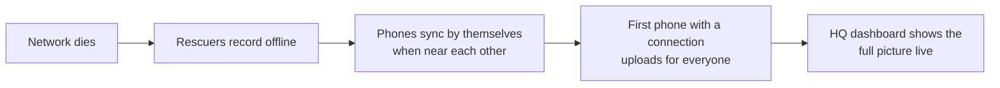

---

## 2. Key features

| Feature | Status |
|---|---|
| Offline recording of missing persons, shelter capacity and inventory movements | ✅ Built |
| Cryptographically signed operations (Ed25519) | ✅ Built |
| Per-region payload encryption (AES-GCM) | ✅ Built |
| Automatic device-to-device sync over Google Nearby Connections | ✅ Built |
| Deterministic state rebuilding, conflict detection and state hash | ✅ Built |
| Persistent on-device storage (`ops_store.json`) | ✅ Built |
| Double-spend prevention for scarce items, covered by the simulator suite | ✅ Built |
| First-to-Sync uplink with node telemetry (battery, status, ops held, state hash) | ✅ Built |
| Live HQ web dashboard with green uplink banner and live feeds | ✅ Built |
| Three role-based app flavors (A1, B1, C1) | ✅ Built |
| Multi-node JVM simulator and automated scenario tests | ✅ Built |

### Screenshots

| Field app | HQ dashboard | Uplink banner |
|---|---|---|
| ![Field app]
 | ![HQ dashboard]|

> Add the three images to `docs/images/` with these file names.

---

## 3. System architecture

### 3.1 End-to-end view

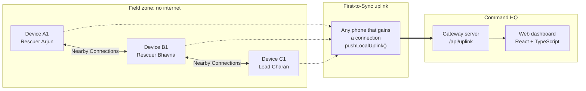

### 3.2 Inside one phone

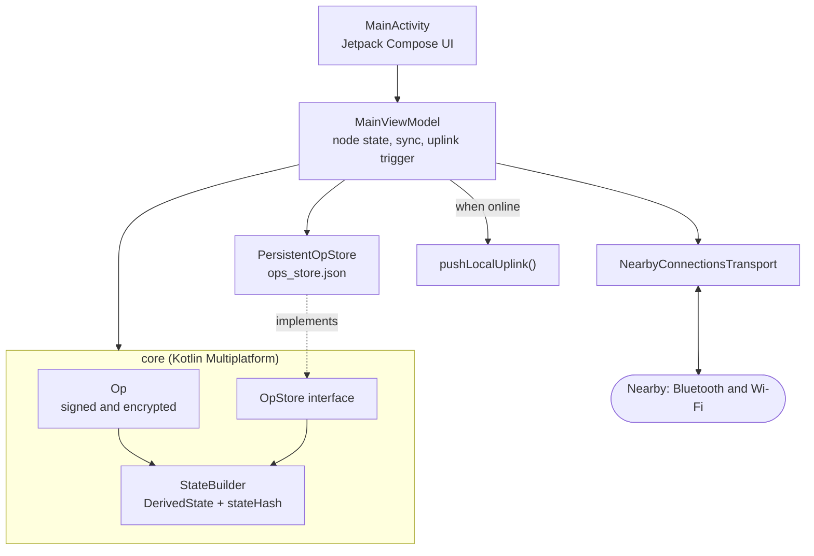

### 3.3 Design rules that make it work

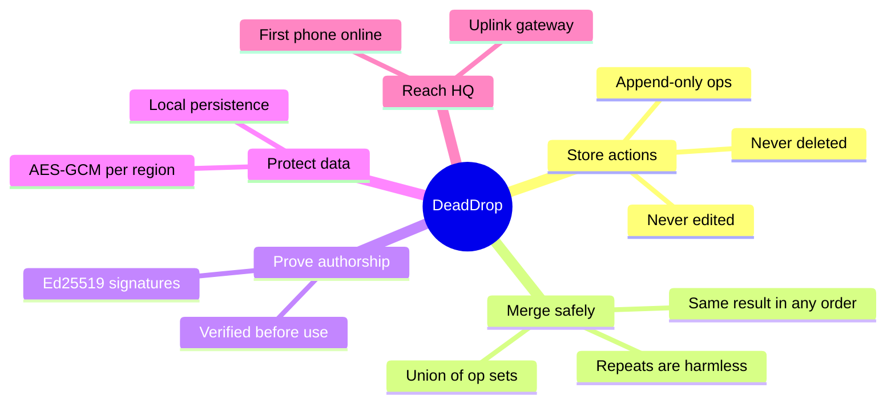

---

## 4. How an operation works

### 4.1 Anatomy of an op

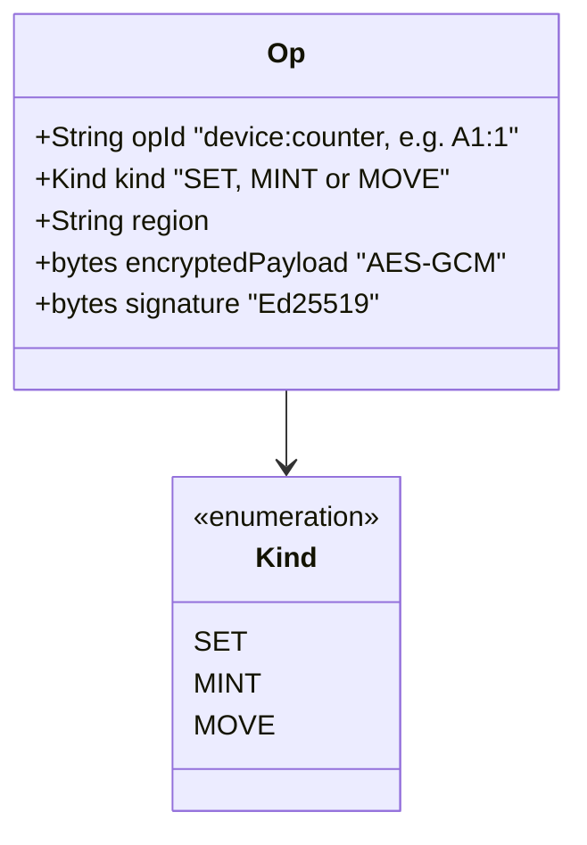

*Simplified for readability. `opId` is the device id plus that device's own counter, so two devices can never create the same id and phone clocks never decide correctness.*

| Kind | Used for |
|---|---|
| `SET` | Recording or changing facts: a missing person, shelter occupancy, a need |
| `MINT` | Creating stock of a scarce item (boats, medkits, blankets) |
| `MOVE` | Moving stock from one holder to another or handing it out |

### 4.2 Life of an op

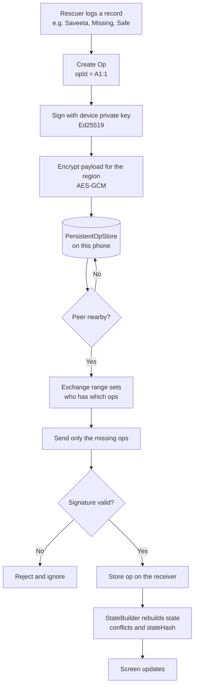

---

## 5. Peer-to-peer sync

### 5.1 The exchange

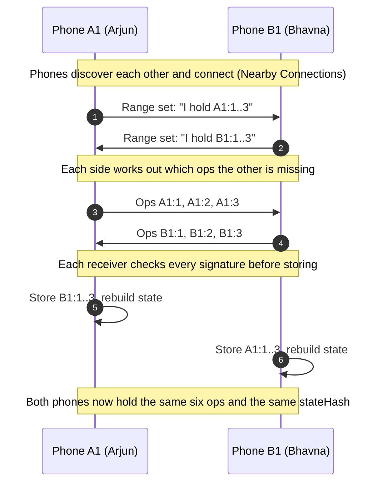

### 5.2 What each phone knows

| Moment | Phone A1 holds | Phone B1 holds | Same state? |
|---|---|---|---|
| Before meeting | `A1:1, A1:2, A1:3` | `B1:1, B1:2, B1:3` | No |
| After sync | `A1:1..3, B1:1..3` | `A1:1..3, B1:1..3` | **Yes** |

### 5.3 Why only missing ops travel

Phones first swap a small summary (range sets) of what they hold. Only the difference is sent, so a short encounter over a weak link is enough, and sending something twice does no harm.

---

## 6. Conflicts and scarce items

### 6.1 Two people edit the same record while apart

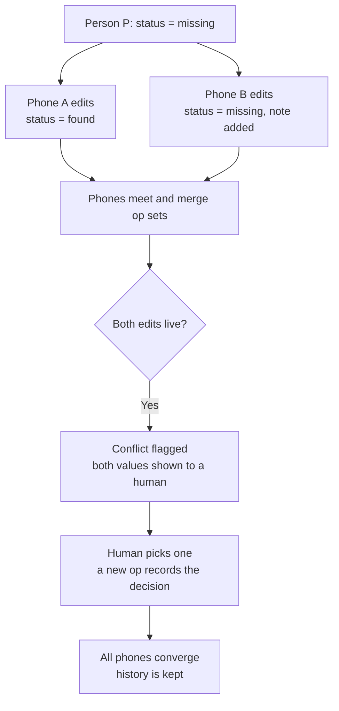

Nothing is overwritten. Both versions stay in the log, so **no update is ever lost**.

### 6.2 Scarce items: no double allocation

Scarce items such as boats, medkits and blankets are tracked with `MINT` and `MOVE` operations. A device can only move stock that it holds, so two disconnected teams cannot both hand out the same unit.

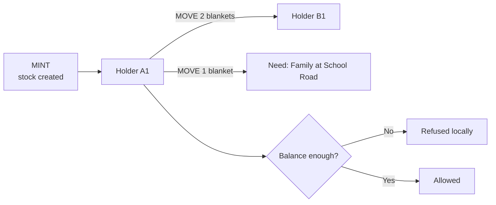

The scenario suite in `sim` covers double-spending prevention (see [Testing](#13-testing-and-evidence)).

---

## 7. First-to-Sync uplink

As soon as **any one phone** gets connectivity (5G, LTE, Wi-Fi, satellite or a local laptop network), it becomes the **Emergency Uplink Gateway**. It sends everything it holds, which includes ops received from the mesh, to Command HQ, along with node telemetry (battery, online status, total ops held) and the consensus state hash.

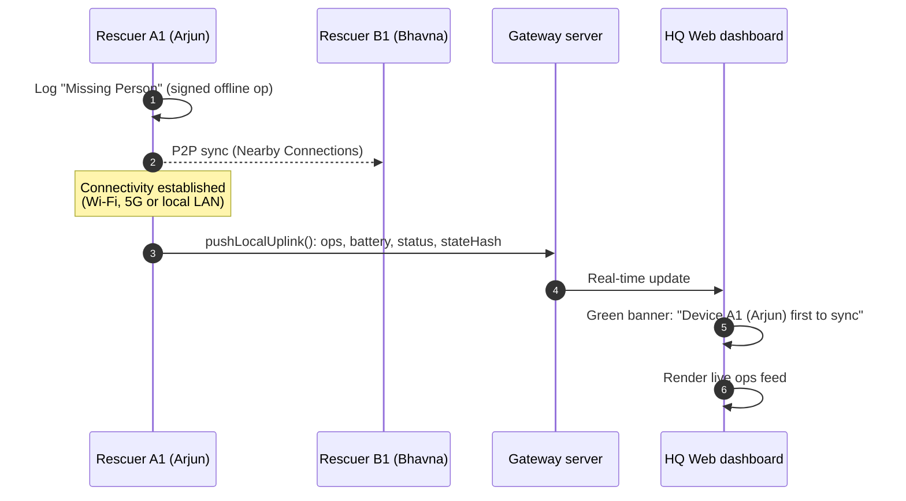

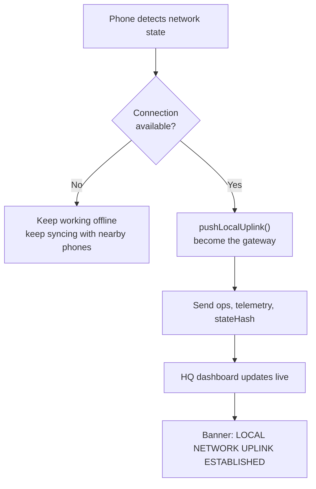

Because phones share ops with each other first, **one** connected phone is enough to bring the whole group's data to HQ.

---

## 8. Security model

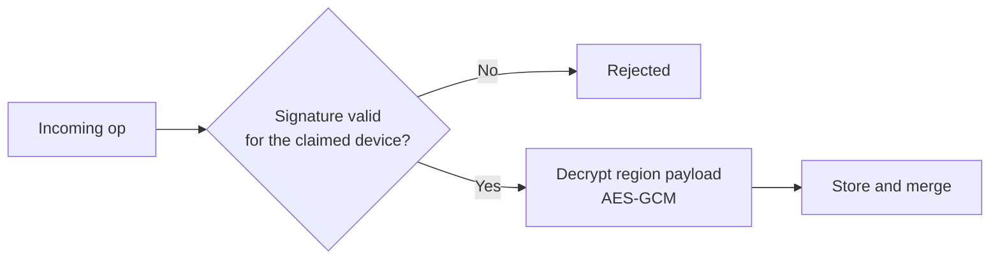

| Threat | Defence |
|---|---|
| A forged or altered record | Every op is signed (Ed25519). Receivers verify before using it |
| A stolen or seized phone reading record contents | Op payloads are encrypted per region (AES-GCM) |
| Edits that silently destroy information | Ops are append-only. Conflicts are shown, never overwritten |
| Two teams claiming the same scarce item | Stock moves through `MINT` and `MOVE`, and a holder can only move what it holds |
| Replayed or repeated messages | Op ids are unique (`device:counter`), so duplicates are ignored |

> Keep private keys on the device only. Never commit private keys, secrets or signing material to the repository.

---

## 9. Partition and convergence

Devices repeatedly split and rejoin. After each merge they must hold the same ops and report the same `stateHash`.

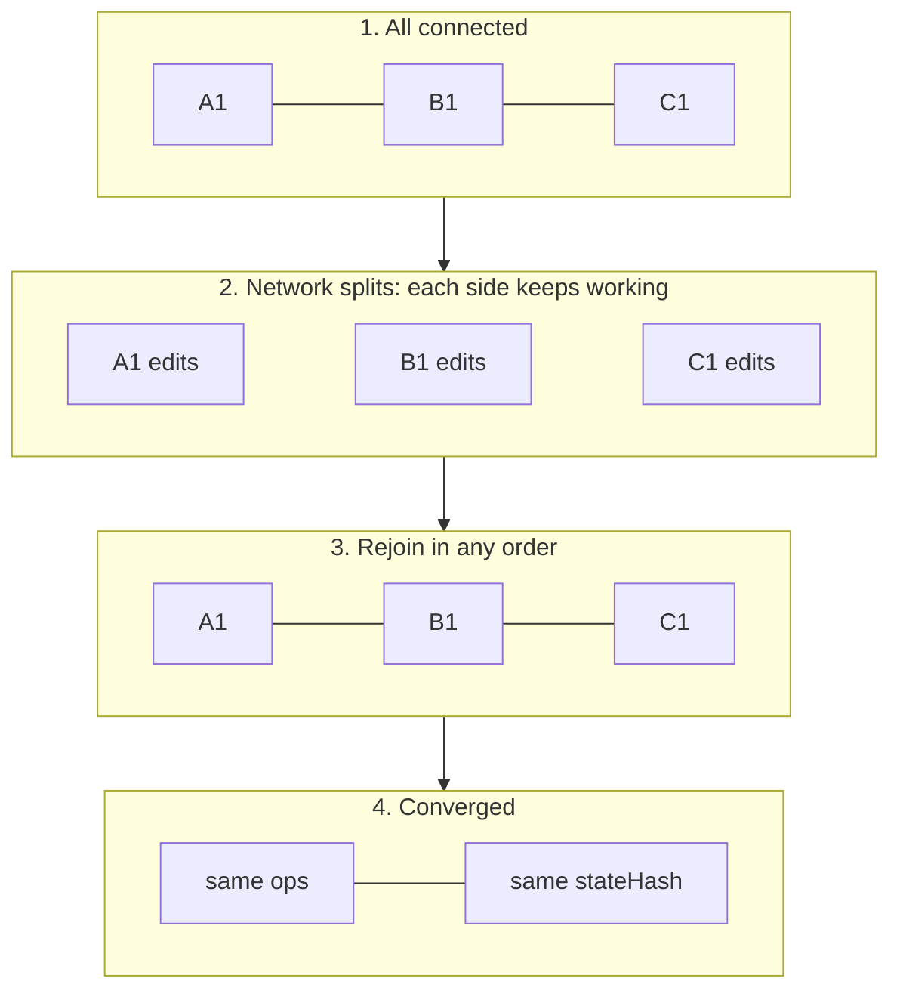

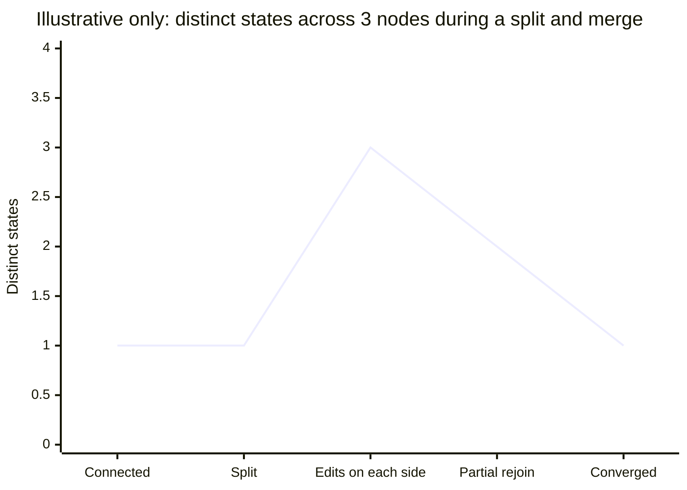

> This chart illustrates the idea and is **not measured data**. Replace it with real numbers from the simulator output (see [Testing](#13-testing-and-evidence)).

---

## 10. Multi-node roles

The Android app has three product flavors, one per emergency field role.

| Flavor | Device ID | Rescuer | Role | Region |
|---|---|---|---|---|
| `deviceA` | `A1` | Arjun | Field Rescuer, North Street | Region A |
| `deviceB` | `B1` | Bhavna | Field Rescuer, South Street | Region A |
| `deviceC` | `C1` | Charan | Group Lead, Base Camp | Region A |

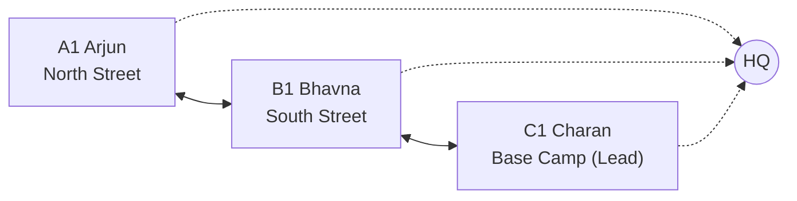

---

## 11. Tech stack and project structure

| Layer | Technology |
|---|---|
| Shared core | Kotlin Multiplatform: `Op`, `StateBuilder`, `DerivedState`, `OpStore`, `InMemoryOpStore` |
| Mobile app | Android, Jetpack Compose, `MainActivity`, `MainViewModel` |
| Persistence | `PersistentOpStore` (JSON file `ops_store.json`) |
| P2P transport | Google Nearby Connections (`NearbyConnectionsTransport`) |
| Cryptography | Ed25519 signatures, AES-GCM payload encryption |
| Simulator | JVM: `VirtualNetwork`, `ScenarioSuiteTest` |
| HQ dashboard | React, TypeScript, Tailwind CSS |
| Gateway (demo) | Node.js `server.cjs` on a laptop |

```text
DeadDrop/
├── core/            Kotlin Multiplatform: Op, StateBuilder, OpStore
├── androidApp/      Android app (flavors deviceA, deviceB, deviceC)
├── sim/             JVM simulator: VirtualNetwork, ScenarioSuiteTest
├── apks/            Pre-built APKs for the three roles
├── docs/images/     Screenshots used in this README
├── server.cjs       Local gateway server for the demo
└── (web dashboard)  React + TypeScript + Tailwind HQ dashboard
```

---

## 12. Build, install and run

### Prerequisites
- Android Studio (2026.1.3 or newer) and JDK 11 or newer
- Android phones with USB debugging enabled
- Node.js 18 or newer for the dashboard and gateway

### Step 1: Install the three apps

**Pre-built APKs** (direct download):

| Role | APK |
|---|---|
| Device A1, Rescuer Arjun | [`apks/DeadDrop-DeviceA-Arjun.apk`](apks/DeadDrop-DeviceA-Arjun.apk) |
| Device B1, Rescuer Bhavna | [`apks/DeadDrop-DeviceB-Bhavna.apk`](apks/DeadDrop-DeviceB-Bhavna.apk) |
| Device C1, Lead Charan | [`apks/DeadDrop-DeviceC-Charan.apk`](apks/DeadDrop-DeviceC-Charan.apk) |

```bash
adb install apks/DeadDrop-DeviceA-Arjun.apk
adb install apks/DeadDrop-DeviceB-Bhavna.apk
adb install apks/DeadDrop-DeviceC-Charan.apk
```

**From source with Gradle:**

```bash
./gradlew :androidApp:installDeviceADebug :androidApp:installDeviceBDebug :androidApp:installDeviceCDebug
```

**Build only:**

```bash
./gradlew :androidApp:assembleDebug
```

### Step 2: Run the local gateway server (laptop)

<details>
<summary>Show <code>server.cjs</code></summary>

```javascript
const http = require('http');
let latestUplink = null;

const server = http.createServer((req, res) => {
  res.setHeader('Access-Control-Allow-Origin', '*');
  res.setHeader('Access-Control-Allow-Methods', 'GET, POST, OPTIONS');
  res.setHeader('Access-Control-Allow-Headers', 'Content-Type');

  if (req.method === 'OPTIONS') { res.writeHead(200); res.end(); return; }

  if (req.method === 'POST' && req.url === '/api/uplink') {
    let body = '';
    req.on('data', chunk => { body += chunk.toString(); });
    req.on('end', () => {
      latestUplink = JSON.parse(body);
      console.log('🟢 FIRST LOCAL UPLINK DETECTED FROM PHONE:', latestUplink);
      res.writeHead(200, { 'Content-Type': 'application/json' });
      res.end(JSON.stringify({ success: true }));
    });
  } else if (req.method === 'GET' && req.url === '/api/uplink') {
    res.writeHead(200, { 'Content-Type': 'application/json' });
    res.end(JSON.stringify(latestUplink || {}));
  }
});

server.listen(5000, '0.0.0.0', () => {
  console.log('🚀 Local Uplink Server listening on http://0.0.0.0:5000');
});
```

</details>

```bash
node server.cjs
```

### Step 3: Run the web dashboard

```bash
npm run dev
```

The dashboard polls `http://localhost:5000/api/uplink` and shows the First-to-Sync banner live.

---

## 13. Testing and evidence

The `sim` module runs several nodes in one JVM over a virtual network you control, then checks the results.

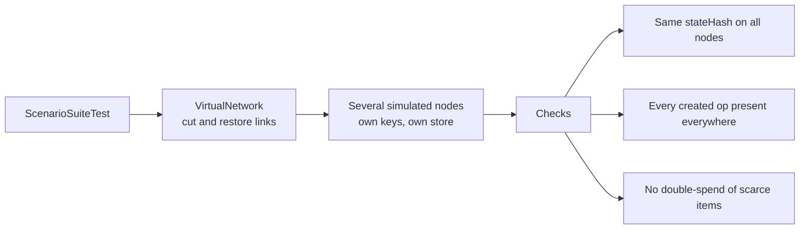

| Scenario | What must hold | Result |
|---|---|---|
| Conflicting edits during a split | Both values kept, conflict flagged, hashes equal after rejoin | ⬜ fill in |
| Double-spend attempt on a scarce item | Second spend is refused | ⬜ fill in |
| Three-way split, rejoin in different orders | Same `stateHash` for every merge order | ⬜ fill in |
| Long isolation of one node | Converges after rejoining, no lost ops | ⬜ fill in |
| Duplicate and out-of-order delivery | Same final state | ⬜ fill in |
| Forged or altered op | Rejected | ⬜ fill in |

Run the suite (adjust the module path to match your Gradle setup):

```bash
./gradlew :sim:test
```

### Sync payload evidence

Fill in these numbers from your own measurements. Do not publish figures you did not measure.

| Measurement | Value |
|---|---|
| Bytes sent in one sync after a small change | ⬜ |
| Size of the full op log at that moment | ⬜ |
| Ratio (sent ÷ full) | ⬜ |

---

## 14. Live demo walkthrough

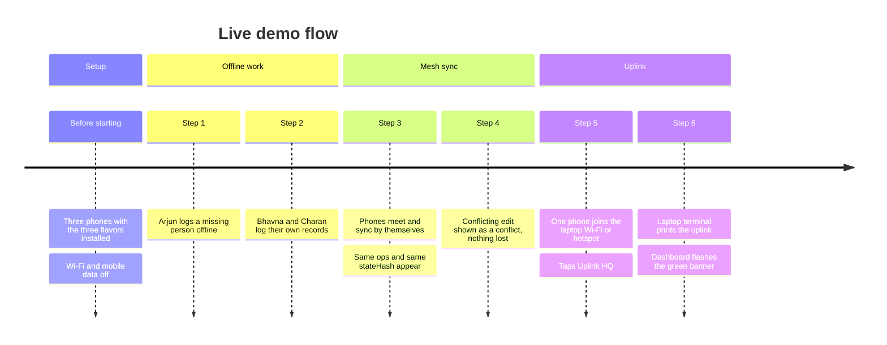

1. **Simulate offline mesh operations.** Turn off Wi-Fi and mobile data. Open **DeadDrop - Arjun (A1)** and add a missing-person record, for example *Saveeta, Found, Safe*.
2. **First-to-Sync gateway test.** Connect one phone to the laptop Wi-Fi or hotspot. Tap **Uplink HQ** (or let the automatic network sync trigger).
3. **Inspect the results.** The laptop terminal prints:
   `🟢 FIRST LOCAL UPLINK DETECTED FROM PHONE: { gatewayDevice: 'A1', gatewayUser: 'Arjun', opsPushed: 12 }`
   The dashboard flashes:

   > 🟢 **LOCAL NETWORK UPLINK ESTABLISHED**: First-to-Sync Gateway: **Device A1 (Arjun)**, pushed 12 ops to HQ

---

## 15. Limitations and roadmap

### Honest limitations
- Phone radios have a short range. Data crosses distance because people move and phones carry and relay ops, so delivery can be delayed when groups stay far apart.
- The ledger tracks what devices *declare*. It cannot see physical reality, such as two people claiming the same boat.
- Signatures prove who wrote an op and that it was not altered. They do not prove that the author is a legitimate rescuer.
- The local gateway server in this repo is a demo setup, not a hardened production service.

### Roadmap

| Item | Description |
|---|---|
| 🔜 Simpler input | One screen with text or offline voice input, with fields extracted and confirmed before saving |
| 🔜 Fairness alerts | Flag when one rescuer holds far more of a scarce item than the rest |
| 🔜 Longer-range links | Plug a longer-range transport in behind the existing transport layer, with no change to the core |
| 🔜 Local-language support | Offline recognition and UI text in local languages |

---

<div align="center">

**Team:** *add team members here*

Built for a hackathon on resilient offline disaster coordination.

</div>
